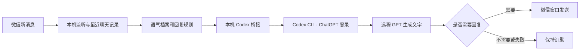

# WeChat Codex Bot

Windows 本机微信机器人：读取指定聊天的上下文，用本人历史发言生成语气档案，通过 Codex CLI 和 ChatGPT 登录调用 GPT，再把文字回复发送到微信。

适合个人电脑轻量部署，无需服务器、域名、Docker 或 wxautox4 Plus 激活码。模型使用你的 Codex 账户额度。它是第三方微信自动化项目，并非微信或 OpenAI 官方机器人。

## 原项目来源与致谢

本项目在以下开源项目基础上增加 Codex 模型桥接、Windows 安装器和部署指南：

- **机器人主体：[fanyuantaier/wechatbot-new](https://github.com/fanyuantaier/wechatbot-new)**，本仓库的 `wechatbot-source/` 修改自该项目。
- **微信自动化驱动：[fanyuantaier/wechatauto-replica](https://github.com/fanyuantaier/wechatauto-replica)**，负责本地聊天读取、监听和微信界面操作。
- **模型调用工具：[openai/codex](https://github.com/openai/codex)**，通过使用者自己的 ChatGPT 登录访问模型。

感谢原作者及上游贡献者。本项目保留原版权声明和许可；具体源版本、修改范围及更早的项目传承见 [THIRD_PARTY_NOTICES.md](THIRD_PARTY_NOTICES.md)。欢迎给原项目打星标支持。

## 快速部署

准备 Windows 10/11、Python 3.11、Node.js、Git、已登录的电脑版微信，以及具有 Codex 使用权限的 ChatGPT 账号。

```powershell
git clone https://github.com/DOCyang001/wechat-codex-bot.git
cd wechat-codex-bot
.\install.cmd
.\start.cmd
```

仓库目前是私有项目；拉取时需要仓库访问权限和 GitHub 登录。安装器会创建 Python 环境、安装依赖、检查或安装 Codex CLI、引导 ChatGPT 登录，然后让你选择微信数据目录、账号和准确聊天名称，并生成语气档案。**安装只准备数据，运行 `start.cmd` 才启用自动回复。**

完整步骤、架构、网络要求和排错见 **[User Guide](USER_GUIDE.md)**。

## 如何与 ChatGPT 配合



ChatGPT 登录用于访问 Codex 模型；本项目不操控 ChatGPT 网页，也不会读取你在 ChatGPT 的其他聊天。上下文由本项目提供，不会自动从桌面 ChatGPT 会话继承。Codex/ChatGPT 桌面窗口无需一直打开，后台 CLI 按请求运行。相关认证说明见 [OpenAI 官方文档](https://developers.openai.com/codex/auth/)。

## 日常操作

| 操作 | 入口 |
|---|---|
| 开启监听和自动回复 | 双击 `start.cmd` |
| 停止机器人及本项目服务 | 双击 `stop.cmd` |
| 查看运行状态和日志 | <http://127.0.0.1:8765/> |
| 修改账号、模型或监听对象 | 停止后编辑 `settings.local.json`，重跑 `install.cmd` |
| 刷新个人语气档案 | 停止后重跑 `install.cmd` |

## 范围和限制

- 仅监听本地配置的联系人和群；名称必须唯一匹配。
- 每次回复参考最近 40 条记录；语气档案从最近 120 条中的本人发言提炼。
- 群消息全部进入判断，模型按规则只回复叫到本人或继续本人话题的消息。这是模型判断，不是保证每次准确的硬性分类器。
- 已由本人回复、无需回应、模型超时或连接失败时，跳过发送。
- 默认关闭图片识别、联网检索、主动问候、提醒、朋友圈和聊天命令。
- 新机器需要自己的微信登录和 ChatGPT 登录；代码不会携带任何人的登录凭据。
- 微信版本、界面变化和模型可用性可能影响运行。当前本机已验证微信 **4.1.15.13** 和 Codex CLI **0.159.2**；未声称覆盖所有版本。

## 数据与许可

配置、数据库密钥、解密缓存、语气档案和日志只写入本机忽略目录，不进入 Git。生成语气档案及回复时，必要的聊天文本会通过 Codex 发往模型服务。

微信部分基于 [wechatbot-new](https://github.com/fanyuantaier/wechatbot-new) 和 [wechatauto-replica](https://github.com/fanyuantaier/wechatauto-replica)。遵循 GPL-3.0-or-later，保留上游署名与许可；版本和修改内容见 [THIRD_PARTY_NOTICES.md](THIRD_PARTY_NOTICES.md)。
